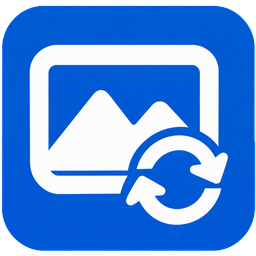
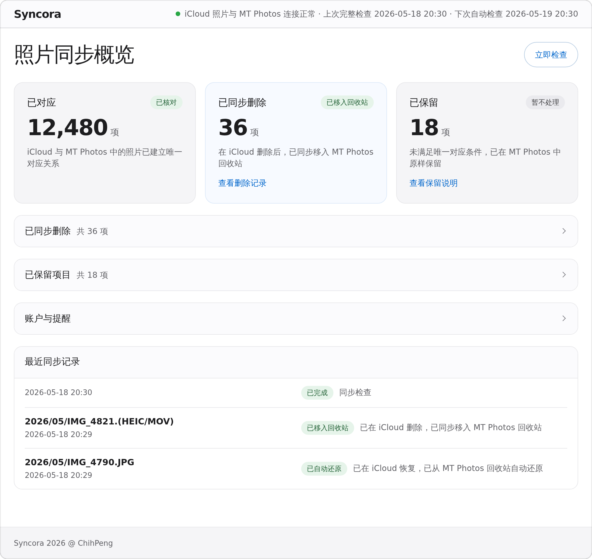

<p align="center">
  
</p>
<h1 align="center">Syncora</h1>
<p align="center">
  <strong>iPhone 删废片，MT Photos 自动进回收站；iPhone 手滑点恢复，MT Photos 自动还原。</strong><br>
  <sub>支持架构：<code>linux/amd64</code>（群晖 / 飞牛 fnOS / 威联通 / 极空间 / Linux） · <code>linux/arm64</code>（ARM NAS / 树莓派 / Apple Silicon）</sub>
</p>

市面上的相册备份工具普遍「**只管上传备份，不管后续清理**」——你在 iPhone（iCloud 照片）里随手删掉的废片、糊片和临时截图，在备份端依然原封不动地留着。

我不放心把私人照片交给第三方网盘，所以在家里 NAS 上用 **MT Photos** 管理着一份本地备份，平时离开苹果设备，在 Windows、Android 或 Linux 上也能随时打开翻看。如果备份只是扔在那儿压箱底倒也无所谓，可平时一跨设备翻相册，满眼都是早就在 iPhone 上删掉的废片——要么忍着，要么就得手动再清一遍。所以我写了 **Syncora**，把这件事自动解决掉。

## 为什么可以放心交给它？（四重安全保障）

相册是最珍贵的私人数据，Syncora 从设计上把「绝不误删、绝不伤原片」放在第一位：

1. **绝不永久删除**：只做「移入 MT Photos 回收站」和「从回收站还原」这两件事，程序底层**没有**清空回收站或彻底删除的功能。
2. **本地原片文件夹强制只读**：你的照片目录以只读（`:ro`）方式挂载，Syncora 连修改或删除硬盘上原始照片文件的权限都没有。
3. **不下载云端原图，不保存密码**：只比对照片的数字指纹，不占网速和硬盘空间重复下载 iCloud 原图；Apple 账号密码与验证码用完即焚，绝不存进硬盘或日志。
4. **拿不准的一律原样保留**：实况照片（Live Photo 照片+动态短视频）和 RAW+JPEG 会整组一起处理，绝不删一半留一半；以前只存在 NAS 里的老照片、重复照片、以及家人 **iCloud 共享图库**里的照片，统统原封不动。

## 它是怎么运转的？

1. **自动认准同一张照片**：后台默认每天核对一次 iCloud 与 MT Photos 里的照片内容指纹，就算改过文件名也能准确对上号。
2. **手机删片，自动进回收站**：当你在 iPhone「照片」里删掉某张照片（进入 iCloud「最近删除」），Syncora 会自动把 MT Photos 里唯一对应的照片移进回收站。
3. **手机恢复，自动还原**：如果不小心删错了，在 iPhone「最近删除」里点一下「恢复」，下次检查时就会自动从 MT Photos 回收站放回原处（如果你自己在 MT Photos 回收站手动恢复了某张照片，它也不会再重复删）。

## 第一步：用 Docker 安装运行

先在 **MT Photos 网页右上角菜单**里点「API 密钥」，创建一个密钥备用（[官方图解](https://mtmt.tech/docs/guide/api_key/)）。

然后复制下面的 `docker-compose.yml` 配置，**只需要把标了 `👈` 的 4 个地方改成你自己的信息**：

```yaml
services:
  syncora:
    image: chihpengkao/syncora:latest
    container_name: syncora
    restart: unless-stopped
    stop_grace_period: 60s
    cap_drop: [ALL]
    security_opt: [no-new-privileges:true]
    ports:
      - "8070:8070"
    volumes:
      # 👈 1. 改这里：存运行数据的独立文件夹（别建在照片文件夹里面）
      - /volume1/docker/syncora:/data/state
      # 👈 2. 改这里：MT Photos 存手机备份照片的文件夹（末尾 :ro 别删）
      - /volume1/photos/iPhone:/photos:ro
    environment:
      TZ: Asia/Shanghai
      # 👈 3. 改这里：你的 MT Photos 访问地址
      MT_BASE_URL: "http://192.168.1.10:8063"
      # 👈 4. 改这里：刚才在 MT Photos 里创建的 API 密钥
      MT_API_KEY: "填你的-MT-Photos-API-密钥"
      # 家里局域网用 http 连 MT Photos 时保留这行（须填 "1"）；用 https 可删掉
      MT_ALLOW_INSECURE_HTTP: "1"
```

- **群晖 / 飞牛 fnOS / 威联通 / 极空间 / Portainer**：打开 Docker 里的「项目 / Compose / Stacks」，新建项目粘贴上面的内容，改好 4 处信息后启动即可。
- **以后怎么更新版本**：在 Docker 项目里点「重新拉取镜像并重建」，或运行 `docker compose pull && docker compose up -d`，已登录的账号和历史记录都会自动保留。

> [!TIP]
> 如果在群晖或飞牛的网页文件管理器里手动新建了数据文件夹，遇到启动后容器反复重启、打不开网页，点开下方「进阶设置」第 5 条加一行 `user` 即可解决。

## 第二步：打开网页，3 分钟完成首次设置

在连着家里同一个 Wi-Fi / 局域网的电脑或手机浏览器中，打开 `http://你的设备IP:8070`（例如 `http://192.168.1.10:8070`）：

1. **激活本机**：点击页面顶部的「**复制机器码**」，[联系作者](#联系作者)获取激活码，粘贴后点击「**激活**」（激活前也可以先登录账号和测试连接）。
2. **登录 Apple 账户**：在展开的「**填写 Apple 账户信息**」中选择地区（云上贵州账号选「**中国大陆**」，海外及港澳台账号选「**其他地区**」），输入 Apple 账号和密码点「**登录**」，再填入手机弹出的 **6 位验证码**（或点「**改用短信接收验证码**」）点击「**完成验证**」。
3. **验证连接并开始**：点击 MT Photos 卡片上的「**验证连接**」，通过后点击右上角「**立即检查**」就全部设好了！

检查完成后，页面会清晰展示三张状态卡片：「**已对应**」（两边对上号的正常照片）、「**已同步删除**」（已移入 MT Photos 回收站的废片）、「**已保留**」（原样留着未动的照片，点开可看原因）。之后它每天会在后台静默运行，平时完全不用再管。

<p align="center">
  <picture>
    <source media="(prefers-color-scheme: dark)" srcset="assets/dashboard-dark.png">
    <source media="(prefers-color-scheme: light)" srcset="assets/dashboard-light.png">
    
  </picture>
</p>

## 进阶设置与常见问题（按需点开）

默认保持上面的配置就能稳定工作，只有遇到下面这些情况时再点开查看：

<details>
<summary><strong>1. 想改自动检查的间隔时间，或者 8070 端口被其他软件占用了？</strong></summary>

- **改检查频率**：默认每天（`86400` 秒）自动检查一次。如果想改成每 4 小时检查一次（`14400` 秒），在 `environment:` 下面加一行：
  ```yaml
  SYNCORA_INTERVAL: "14400"
  ```
- **改网页端口**：直接改 `ports:` 冒号**左边**的数字即可，比如改成 `- "18070:8070"`，重启后用 `:18070` 打开网页（冒号右边的 `8070` 固定别改，也不要往 `environment:` 里加端口设置）。

</details>

<details>
<summary><strong>2. MT Photos 里文件夹很多，只想让它管指定的手机相册目录？</strong></summary>

默认会自动识别备份目录。如果 MT Photos 里存了多台设备、多个顶层目录，或者页面提示需要指定目录范围，可以在 `environment:` 下面加一行 `MT_FOLDERS`，填入 MT Photos 里看到的文件夹路径（以 `/` 开头，多个目录用英文逗号隔开，并确保与第 2 项挂载的照片文件夹对应）：

```yaml
MT_FOLDERS: "/iPhone15Pro"
```

如果家人有另一个独立的 Apple 账号也想同步，只需新建另一个数据文件夹、换个左边端口号，再运行第二个容器即可（每个数据文件夹固定绑定首次登录的 Apple 账号）。

</details>

<details>
<summary><strong>3. 想开启 HTTPS 加密，或者用反向代理在外网打开网页？</strong></summary>

为保护你的 Apple 账号密码，只有在家用局域网地址直连时才允许用普通 `http://` 登录；通过外部域名或反向代理访问时，必须开启 `https://`：

- **局域网一键自签名 HTTPS**：在 `environment:` 下面加上这两行（把 IP 换成你访问用的设备地址），重启后改用 `https://` 打开网页并信任证书即可：
  ```yaml
  SYNCORA_TLS_AUTO: "1"
  SYNCORA_ALLOWED_HOSTS: "192.168.1.10"
  ```
- **自有证书开启 HTTPS**：在 `volumes:` 加一行 `- /你的证书文件夹:/certs:ro`（请放证书实际文件，不要放软链接/快捷方式），并在 `environment:` 加上：
  ```yaml
  SYNCORA_TLS_CERT: "/certs/fullchain.pem"
  SYNCORA_TLS_KEY: "/certs/privkey.pem"
  ```
- **群晖反向代理 / Nginx / Caddy 外网访问**：外部反向代理开启 HTTPS 并转发到 `8070` 端口，在 `environment:` 加上你的外部域名和本地代理网段：
  ```yaml
  SYNCORA_ALLOWED_HOSTS: "syncora.example.com"
  SYNCORA_TRUSTED_PROXIES: "127.0.0.1,172.16.0.0/12"
  ```
  同机运行反向代理时，可把 `ports:` 改成 `- "127.0.0.1:8070:8070"`。**如果向公网开放，请务必在反向代理上设置访问密码保护**；以 Nginx 为例，在已配好 HTTPS 的站点中加入：
  ```nginx
  auth_basic "Syncora";
  auth_basic_user_file /etc/nginx/syncora.htpasswd;
  
  location / {
      proxy_pass http://127.0.0.1:8070;
      proxy_set_header Host $host;
      proxy_set_header X-Forwarded-Host $host;
      proxy_set_header X-Forwarded-Port $server_port;
      proxy_set_header X-Forwarded-Proto $scheme;
      proxy_set_header Authorization "";
  }
  ```

</details>

<details>
<summary><strong>4. 想在 Apple 登录过期或断连时收到邮件提醒？</strong></summary>

放后台长期运行时，如果配好 [Mailgun](https://www.mailgun.com/) 邮件服务，万一过几个月 Apple 登录过期或连不上 MT Photos，它会自动给你发 **1 封**提醒邮件（同一次异常只发 1 封绝不刷屏，恢复正常后自动重置）。在 `environment:` 下面加上这 3 行，重启后可在网页底部「**账户与提醒**」点「**发送测试邮件**」验证：

```yaml
MAILGUN_API_KEY: "你的-Mailgun-API-密钥"
MAILGUN_DOMAIN: "mg.example.com"
MAILGUN_TO_EMAIL: "你的收件邮箱@example.com"
```

（若使用 Mailgun 欧洲区，再加一行 `MAILGUN_BASE_URL: "https://api.eu.mailgun.net"`；也可加 `MAILGUN_FROM_EMAIL` 自定义发件人显示名。）

</details>

<details>
<summary><strong>5. 启动后容器反复重启打不开网页、没显示机器码，或以后换设备怎么备份？</strong></summary>

- **启动后容器反复重启、打不开网页**（群晖 / 飞牛常见）：因为你在网页文件管理器里手动新建数据文件夹时，文件夹归属于你的 NAS 账号。在 `container_name: syncora` 下面加一行 `user` 填上你的账号 ID（群晖首个管理员通常是 `"1026:100"`，飞牛通常是 `"1000:1001"`）重新启动即可：
  ```yaml
  user: "1026:100"
  ```
- **网页提示未能读取机器码**（虚拟机常见）：在宿主机将本机识别码保存为文本文件 `host-uuid`（例如 Linux 主机可执行 `sudo cp /sys/class/dmi/id/product_uuid ./host-uuid && sudo chmod 644 ./host-uuid`，文件请放在数据目录和照片目录之外），然后在 `volumes:` 下面加一行 `- ./host-uuid:/run/syncora-host/product_uuid:ro` 重新启动，刷新网页就会显示机器码了。
- **日常备份与换机**：登录状态、同步记录和激活文件（`activation.lic`）都在数据文件夹里。备份前先停一下容器再复制整个文件夹；原设备重装系统直接挂回就能接着用，只有换了主板或换新 NAS 硬件时才需重新[联系作者](#联系作者)激活。

</details>

<details>
<summary><strong>6. 安装前早就从 iPhone 彻底删掉的老废片，会自动清理吗？</strong></summary>

**不会**，它们会安全归在「**已保留**」里。因为很多人的 NAS 里还存着早年旧手机、相机导进去但没传上 iCloud 的珍贵老照片——如果看到「iCloud 里没有」就自动删除，会把这些独有老照片误删掉。

Syncora 只会清理**两边确认是同一张、并且明确出现在你 iCloud「最近删除」里**的照片。以前攒下的陈年废片在 MT Photos 里手动清理一次，往后的日常新照片就全自动省心了。

</details>

## 联系作者

- 小红书：[@archery](https://www.xiaohongshu.com/user/profile/5b9f9b92b1da140f62e27c0f)
- 抖音：[@archery_kao](https://www.douyin.com/user/MS4wLjABAAAAb1sO948G9YfnzFIUDDTRakorJzanrlggXgPurl4lFP0)
